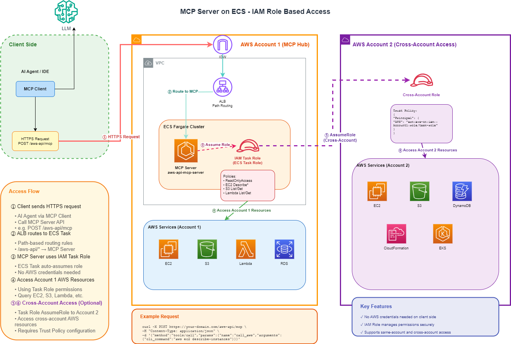

# ECS Remote MCP Hosting Platform

Host AWS MCP servers on ECS Fargate with path-based routing via ALB. Clients connect over HTTPS — no AWS credentials needed on client machines.

## Why Remote MCP?

Local MCP servers require AWS credentials on every client, making cross-account access, credential rotation, and cloud-based AI agent integration painful. This platform centralizes MCP hosting with IAM Task Roles, automatic credential management, and a single HTTPS endpoint for all services.

## Supported MCP Services

| Service | Transport | Description | PR |
|---------|-----------|-------------|----|
| **aws-api-mcp-server** | streamable-http | AWS CLI operations with cross-account support | [#2702](https://github.com/awslabs/mcp/pull/2702) |
| **aws-documentation-mcp-server** | streamable-http | AWS China documentation search | [#2247](https://github.com/awslabs/mcp/pull/2247) |

Both services use custom forks with HTTP transport support. Once PRs merge, switch to official images via `terraform.tfvars`.

## Architecture



- Clients → HTTPS → ALB (path-based routing) → ECS Fargate tasks in private subnets
- ECS Task Role → same-account AWS API calls + cross-account AssumeRole
- No credentials stored on client side

## Quick Start

### Prerequisites

- AWS CLI configured
- Terraform >= 1.0 (AWS Provider >= 6.28)
- Docker
- Access to AWS China region (cn-northwest-1)

### Step 1: Configure

Copy and edit the example config:

```bash
cp terraform/terraform.tfvars.example terraform/terraform.tfvars
```

Key settings in `terraform.tfvars`:

```hcl
deploy_aws_api = true
deploy_aws_doc = true

# HTTPS (optional)
enable_https    = true
certificate_arn = "arn:aws-cn:acm:cn-northwest-1:<account-id>:certificate/xxx"
```

**HTTPS prerequisites** (Terraform does not manage DNS or certificates):
1. Register a domain with valid ICP filing (备案) — required for China regions
2. Request or import a certificate in ACM (`aws acm request-certificate` or import via console)
3. After deployment, add a CNAME record pointing your domain to the ALB DNS name (`terraform output alb_dns_name`)

If you don't have a certificate yet, set `enable_https = false` and use the [local proxy workaround](#testing-without-https) for testing.

### Step 2: Build Images

Build the fork images and push to ECR. The scripts automatically write the image URI to `terraform.tfvars`:

```bash
# Build aws-api (cross-account support fork)
./scripts/build-and-deploy-aws-api.sh

# Build aws-doc (streamable-http fork)
./scripts/build-and-deploy-aws-doc.sh
```

After PRs merge upstream, remove the `aws_api_image` / `aws_doc_image` lines from `terraform.tfvars` to use default official images.

### Step 3: Deploy

```bash
cd terraform
terraform init
terraform apply
```

### Step 4: Security Group

Add your client IP to the ALB security group (not managed by Terraform to avoid committing IPs):

```bash
SG_ID=$(cd terraform && terraform output -raw alb_security_group_id)
aws ec2 authorize-security-group-ingress \
  --group-id $SG_ID --protocol tcp --port 443 \
  --cidr <your-ip>/32 --region cn-northwest-1 --no-paginate
```

### Step 5: Configure MCP Client

```bash
terraform output mcp_endpoints
```

Example Kiro IDE config (`.kiro/settings/mcp.json`):

```json
{
  "mcpServers": {
    "aws-api-ecs-remote": {
      "url": "https://your-domain.com/aws-api/mcp",
      "headers": {
        "Accept": "application/json, text/event-stream",
        "Content-Type": "application/json"
      },
      "autoApprove": ["call_aws", "suggest_aws_commands"],
      "timeout": 120000
    },
    "aws-doc-ecs-remote": {
      "url": "https://your-domain.com/aws-doc/mcp",
      "headers": {
        "Accept": "application/json, text/event-stream",
        "Content-Type": "application/json"
      },
      "autoApprove": ["get_available_services", "read_documentation"],
      "timeout": 120000
    }
  }
}
```

ALB automatically rewrites paths: `https://domain.com/aws-api/mcp` → container `/mcp`.

### Testing Without HTTPS

StreamableHTTP requires HTTPS or localhost. Without a certificate, use a local proxy:

```bash
# Deploy with enable_https = false, then:
socat TCP-LISTEN:8003,fork,reuseaddr TCP:<alb-dns-name>:80
# Use http://127.0.0.1:8003/aws-api/mcp in MCP client config
```

### Test Connection

```bash
curl -X POST https://your-domain.com/aws-api/mcp \
  -H "Accept: application/json, text/event-stream" \
  -H "Content-Type: application/json" \
  -d '{"jsonrpc":"2.0","method":"initialize","params":{"protocolVersion":"2025-11-25","capabilities":{},"clientInfo":{"name":"test","version":"1.0"}},"id":1}'
```

## Cross-Account Support

ECS task role can assume roles in target accounts dynamically — no hardcoded account IDs.

### Usage

```python
call_aws(
  cli_command="aws s3api list-buckets --region cn-northwest-1",
  role_arn="arn:aws-cn:iam::<TARGET_ACCOUNT_ID>:role/McpCrossAccountReadOnly"
)
```

### Deploy Cross-Account Role

A CloudFormation template at `cfn/mcp-cross-account-role.yaml` creates a read-only role trusting the ECS task role.

```bash
TASK_ROLE_ARN=$(cd terraform && terraform output -raw task_role_arn)

# Single account
aws cloudformation create-stack \
  --stack-name mcp-cross-account-role \
  --template-body file://cfn/mcp-cross-account-role.yaml \
  --parameters ParameterKey=McpTaskRoleArn,ParameterValue=$TASK_ROLE_ARN \
  --capabilities CAPABILITY_NAMED_IAM

# Or batch via StackSets (requires AWS Organizations)
aws cloudformation create-stack-set \
  --stack-set-name mcp-cross-account-role \
  --template-body file://cfn/mcp-cross-account-role.yaml \
  --parameters ParameterKey=McpTaskRoleArn,ParameterValue=$TASK_ROLE_ARN \
  --capabilities CAPABILITY_NAMED_IAM \
  --permission-model SERVICE_MANAGED \
  --auto-deployment Enabled=true,RetainStacksOnAccountRemoval=false \
  --region cn-northwest-1
```

## Cost Estimation (cn-northwest-1, CNY)

| Component | 1 service | 2 services |
|-----------|-----------|------------|
| ECS Fargate (0.5 vCPU + 1GB) | ¥111 | ¥223 |
| NAT Gateway + data | ¥289 | ¥307 |
| ALB + LCU | ¥166 | ¥166 |
| CloudWatch Logs | ¥2 | ¥5 |
| **Total** | **~¥569/mo** | **~¥701/mo** |

Tips: disable unused services, use Fargate Spot for non-prod, reduce log retention.

## Security

- ECS tasks in private subnets, no direct internet access
- ALB restricted to specific IPs via security groups (user-managed, not in Terraform)
- IAM Task Role with ReadOnlyAccess (no write operations)
- HTTPS with ACM certificates (optional)
- No AWS credentials on client machines

## Cleanup

```bash
cd terraform && terraform destroy
```

## License

Apache-2.0
